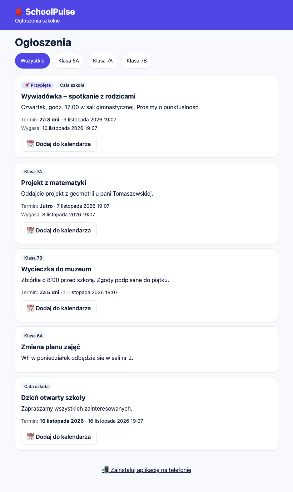
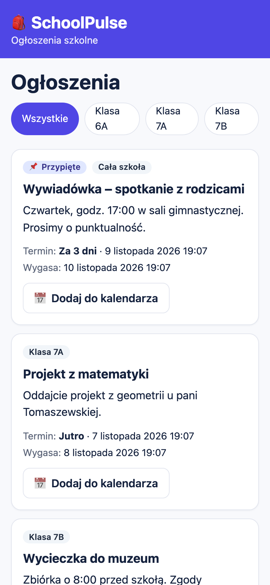
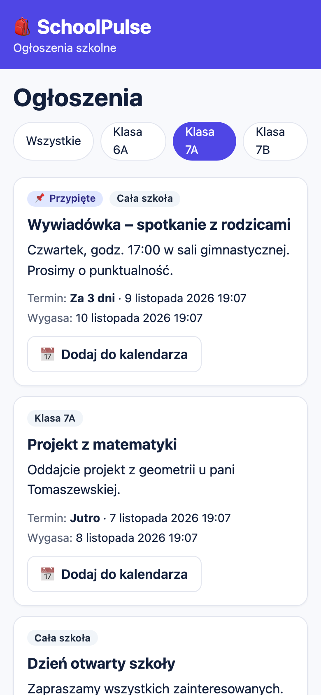
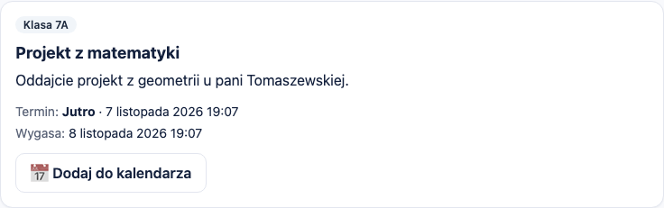
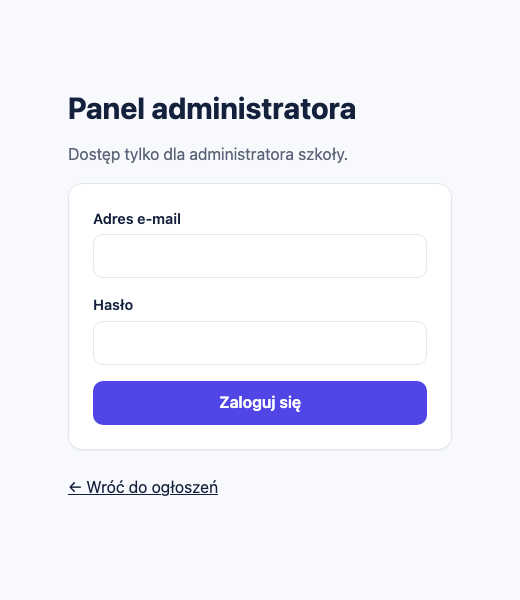
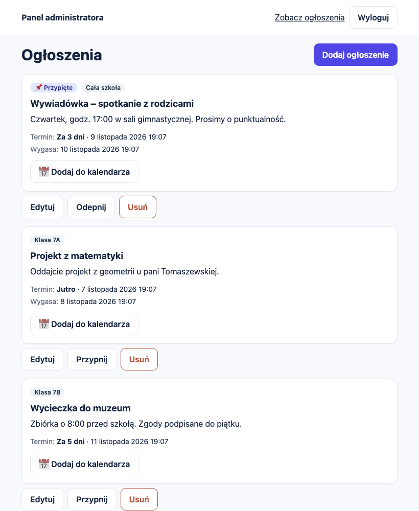
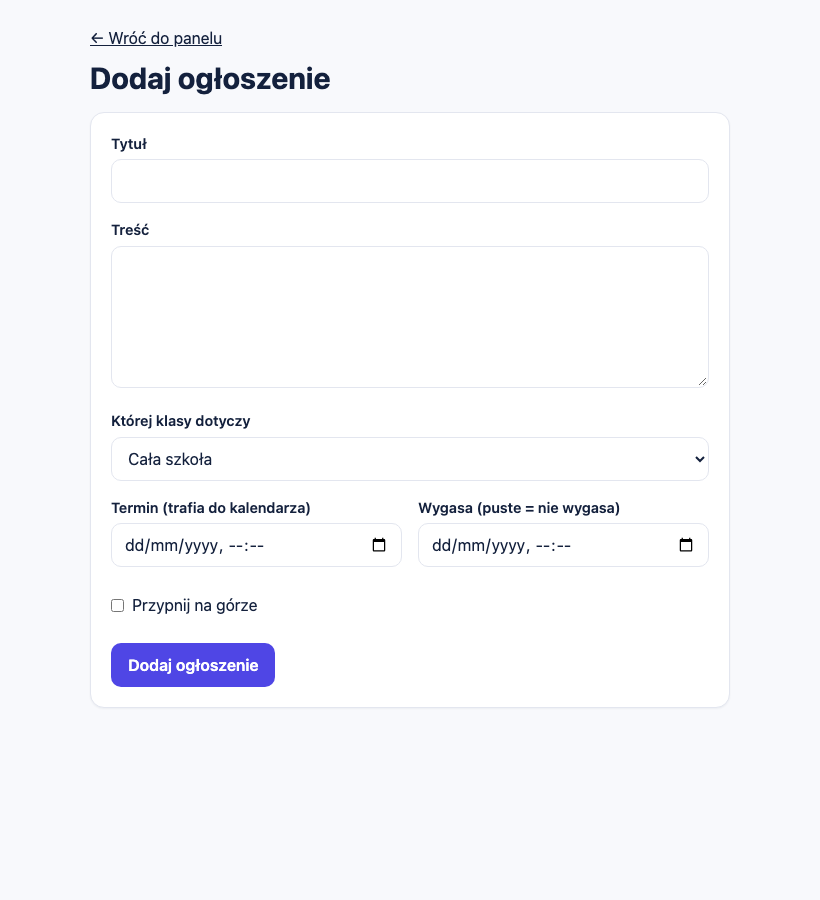
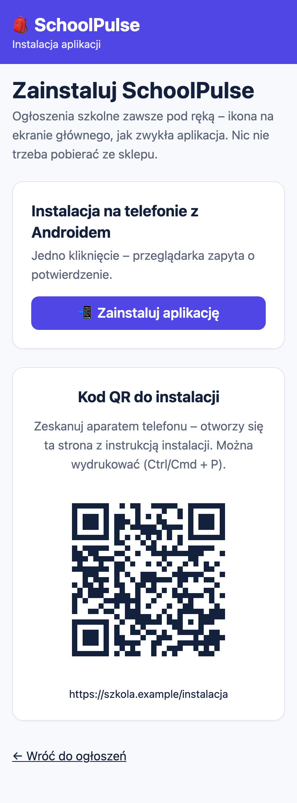
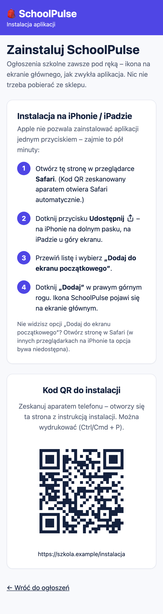

# SchoolPulse – dokumentacja projektu

SchoolPulse to prosta aplikacja internetowa z ogłoszeniami szkolnymi. Uczniowie i rodzice otwierają jedną stronę zamiast przeszukiwać grupy na komunikatorach. Administrator dodaje ogłoszenia w osobnym panelu. Aplikację można zainstalować na telefonie jak zwykłą aplikację, bez sklepu.

Repozytorium: <https://github.com/mat-jan/school-announcements>

## 1. Do czego to służy

Informacje szkolne rozchodzą się dziś po wielu grupach i wiadomościach. Ważne ogłoszenie ginie między zdjęciami i odpowiedziami, a po tygodniu nikt nie wie, czy termin jest jeszcze aktualny. SchoolPulse robi jedną rzecz: pokazuje aktualne ogłoszenia w jednym miejscu, w kolejności, która ma sens.

Każde ogłoszenie ma tytuł i treść oraz cztery cechy, które wystarczają na co dzień:

- **klasę** – dotyczy jednej klasy albo całej szkoły,
- **przypięcie** – przypięte ogłoszenia są zawsze na górze,
- **termin** – data i godzina, np. oddania projektu lub spotkania; z terminu można jednym kliknięciem zrobić wpis w kalendarzu telefonu,
- **datę wygaśnięcia** – po niej ogłoszenie samo znika z listy, więc nikt nie musi go sprzątać.

Aplikacja nie ma kont uczniów, komentarzy ani czatu. To celowe: ma być podobna do tablicy ogłoszeń na korytarzu, tylko aktualna i zawsze pod ręką.

## 2. Jak to wygląda

### 2.1. Strona dla uczniów i rodziców

Pierwszy ekran to lista ogłoszeń. Nie trzeba się logować. Na górze są ogłoszenia przypięte, niżej najnowsze. Przyciski z nazwami klas zawężają listę do wybranej klasy (razem z ogłoszeniami dla całej szkoły).



*Lista ogłoszeń. Przypięta wywiadówka jest na górze, każde ogłoszenie pokazuje klasę, termin i datę wygaśnięcia.*

<p align="center">

&nbsp;&nbsp;

</p>

*Ta sama strona na telefonie, po lewej wszystkie ogłoszenia, po prawej po wybraniu klasy 7A.*

Przy ogłoszeniu z terminem jest przycisk **Dodaj do kalendarza**. Pobiera on plik kalendarza (.ics), który otwiera się w Kalendarzu na iPhonie, w Kalendarzu Google i w Outlooku. Wpis trwa pół godziny i zawiera przypomnienie dzień wcześniej.

<p align="center">

</p>

### 2.2. Panel administratora

Panel jest osobną częścią aplikacji, dostępną pod adresem `/admin`. Nie ma do niego odnośnika na stronie publicznej, a wejście wymaga zalogowania.



Po zalogowaniu administrator widzi wszystkie ogłoszenia, także wygasłe. Przy każdym są trzy przyciski: **Edytuj**, **Przypnij** (albo **Odepnij**) i **Usuń**. Usunięcie wymaga potwierdzenia.



Nowe ogłoszenie dodaje się w jednym formularzu. Termin i datę wygaśnięcia można zostawić puste.



### 2.3. Instalacja na telefonie

Strona `/instalacja` jest przeznaczona do kodu QR, który można wydrukować i powiesić w szkole. Po zeskanowaniu kodu telefon otwiera stronę dopasowaną do systemu:

- na **Androidzie** (Chrome) jest przycisk **Zainstaluj aplikację**, który otwiera natywne okno instalacji,
- na **iPhonie** i iPadzie (Safari) strona pokazuje cztery kroki: Udostępnij, Dodaj do ekranu początkowego, Dodaj. Apple nie pozwala uruchomić instalacji z poziomu strony, więc instrukcja jest konieczna,
- na komputerze strona wyjaśnia, że aplikację instaluje się na telefonie, i pokazuje sam kod QR.

Po instalacji aplikacja otwiera się z ikony, bez paska przeglądarki.

<p align="center">

&nbsp;&nbsp;

</p>

*Po lewej Android z przyciskiem instalacji, po prawej iPhone z instrukcją krok po kroku. Adres w kodzie QR na zrzutach jest przykładowy.*

## 3. Jak z tego korzystać

### Odwiedzający

1. Otwórz stronę główną. Ogłoszenia są od razu widoczne.
2. Wybierz klasę przyciskiem nad listą, jeśli interesują Cię tylko jej ogłoszenia.
3. Przy ogłoszeniu z terminem naciśnij **Dodaj do kalendarza** i otwórz pobrany plik.
4. Na dole strony jest odnośnik do instalacji aplikacji na telefonie.

Lista pokazuje 20 ogłoszeń na stronę, starsze są pod przyciskiem **Starsze**. Ogłoszenia po dacie wygaśnięcia nie są wyświetlane.

### Administrator

1. Wejdź na `/admin/logowanie` i zaloguj się.
2. Kliknij **Dodaj ogłoszenie** i wypełnij formularz:

| Pole | Opis |
|---|---|
| Tytuł | od 3 do 120 znaków |
| Treść | do 2000 znaków, zwykły tekst |
| Której klasy dotyczy | jedna z klas albo „Cała szkoła” |
| Termin | opcjonalnie; od niego zależy przycisk kalendarza |
| Wygasa | opcjonalnie; puste oznacza, że ogłoszenie nie wygasa. Nie może być wcześniejsze niż termin |
| Przypnij na górze | ogłoszenie zostaje na początku listy |

3. Zmieniasz ogłoszenie przyciskiem **Edytuj**, przypinasz lub odpinasz przyciskiem **Przypnij** i usuwasz przyciskiem **Usuń**.
4. Na dole panelu dodajesz klasy. Klasy, do których przypisano ogłoszenia, nie da się usunąć.
5. Na końcu użyj przycisku **Wyloguj**. Sesja jest odświeżana automatycznie, więc na cudzym komputerze wylogowanie jest konieczne.

Błędy w formularzu są opisane po polsku, a wpisane dane zostają w polach.

Administratorem jest konto, które znajduje się na liście administratorów w bazie. Samo założenie konta nie daje dostępu do panelu, a aplikacja nie ma żadnej funkcji nadawania uprawnień. Nowego administratora dodaje właściciel projektu bezpośrednio w bazie danych.

## 4. Jak to jest zbudowane

```
 Telefon / przeglądarka (PWA)
            │  HTTPS
            ▼
 Vercel: aplikacja Next.js (strony, akcje serwerowe)
            │
            ▼
 Supabase: logowanie (Auth) + baza PostgreSQL z regułami dostępu (RLS)
```

Strona publiczna czyta dane bez logowania, ale baza zwraca tylko ogłoszenia, które nie wygasły. Panel zapisuje dane w imieniu zalogowanego administratora, więc te same reguły w bazie obowiązują także przy zapisie.

| Element | Rozwiązanie |
|---|---|
| Aplikacja | Next.js 16 (App Router), React 19, TypeScript |
| Wygląd | Tailwind CSS, interfejs w całości po polsku |
| Logowanie i dane | Supabase: Auth i PostgreSQL z Row Level Security |
| Hosting | Vercel |
| Instalacja | PWA: manifest, ikony PNG, service worker z ekranem offline |
| Walidacja | zod, komunikaty po polsku |
| Testy | Vitest, Playwright, testy na prawdziwej bazie |

### Model danych

Baza ma trzy tabele.

| Tabela | Zawartość |
|---|---|
| `classes` | nazwy klas (unikalne, bez względu na wielkość liter) |
| `announcements` | tytuł, treść, klasa (puste = cała szkoła), przypięcie, termin, data wygaśnięcia, daty utworzenia i zmiany |
| `admins` | identyfikatory kont, które mają dostęp do panelu |

Dla listy publicznej założono indeksy po kolejności wyświetlania (przypięte, najnowsze), po dacie wygaśnięcia i po klasie. Lista pobiera dane stronami, jednym zapytaniem na stronę.

### Czas

Terminy są zapisywane w UTC, a wprowadzane i wyświetlane w czasie polskim (Europe/Warsaw), także w okolicach zmiany czasu. Plik kalendarza ma poprawną godzinę niezależnie od strefy telefonu.

## 5. Bezpieczeństwo

Dane w tej aplikacji nie są poufne, ale panel zmienia to, co widzą wszyscy, więc zabezpieczono go starannie.

| Zagrożenie | Zabezpieczenie |
|---|---|
| Ktoś zapisuje dane bez uprawnień | Reguły w bazie (RLS): zapis tylko dla administratora z tabeli `admins`. Sprawdzone testami na prawdziwej bazie, także dla zwykłego zalogowanego użytkownika |
| Ktoś nadaje sobie rolę administratora | Rola pochodzi wyłącznie z tabeli w bazie, nie z przeglądarki. Tabeli nie da się zmienić przez API |
| Wejście do panelu bez logowania | Sesję sprawdza serwer przy każdej stronie i każdej akcji, a nie tylko ukryte przyciski |
| Zgadywanie haseł | Limit 5 nieudanych prób na 15 minut oraz wbudowane limity logowania w Supabase. Błąd nie zdradza, czy konto istnieje |
| Wyciek klucza administracyjnego | Aplikacja używa tylko klucza publicznego. Klucz z pełnym dostępem nie występuje w kodzie aplikacji ani w plikach wysyłanych do przeglądarki |
| Złośliwa treść ogłoszenia | Treść to zwykły tekst, wyświetlany z ucieczką znaków. Aplikacja nie wstawia kodu HTML |
| Ukryte dane wygasłych ogłoszeń | Baza nie zwraca ich osobom niezalogowanym, także przy bezpośrednim zapytaniu do API |
| Konto testowe w produkcji | Konto istnieje tylko w bazie deweloperskiej. Aplikacja produkcyjna odrzuca takie logowanie, a przed wdrożeniem skrypty sprawdzają konfigurację i bazę |

Panel i jego odpowiedzi mają nagłówek zakazujący indeksowania przez wyszukiwarki. Strony wysyłają też standardowe nagłówki bezpieczeństwa.

## 6. Środowiska i wdrożenie

Projekt działa w trzech środowiskach z osobnymi bazami danych:

| Środowisko | Gałąź | Hosting | Baza |
|---|---|---|---|
| Lokalne | dowolna | komputer programisty | lokalny Supabase w Dockerze |
| Testowe | `develop` | Vercel Preview (chronione logowaniem Vercel) | osobny projekt Supabase |
| Produkcyjne | `main` | Vercel Production | osobny projekt Supabase |

Środowisko testowe nigdy nie łączy się z bazą produkcyjną. Dane demonstracyjne i konto testowe powstają tylko w środowisku deweloperskim. Gałąź `main` jest przygotowywana osobnym skryptem, który usuwa wszystko, co deweloperskie, a przed wdrożeniem uruchamiane są kontrole: czy konfiguracja produkcyjna nie zawiera ustawień testowych, czy w repozytorium nie ma danych demonstracyjnych i czy produkcyjna baza nie zawiera konta testowego.

Budowa na darmowych planach Vercel i Supabase jest zamierzona. Aplikacja nie używa zadań w tle ani połączeń w czasie rzeczywistym, nie przechowuje obrazów i pobiera dane stronami, więc zużycie zasobów jest niewielkie. Darmowy plan Supabase usypia projekt po tygodniu bez ruchu i nie tworzy kopii zapasowych do odtworzenia, dlatego ważne dane warto okresowo eksportować.

## 7. Testy

Testy uruchamia się poleceniami `npm test`, `npm run test:rls`, `npm run test:e2e`, `npm run test:install` i `npm run test:prod`. Poniżej wynik ostatnich przebiegów (listopad 2026).

| Rodzaj testów | Liczba | Co sprawdzają |
|---|---|---|
| Jednostkowe | 18 | wygasanie, plik kalendarza, walidacja, czas polski, reguły produkcji |
| Autoryzacja na prawdziwej bazie | 18 | kto może czytać i zapisywać dane, ograniczenia bazy |
| Przeglądarkowe (Playwright) | 32 | przebiegi administratora i odwiedzającego, telefon, tablet i komputer, dostępność, tryb offline |
| Strona instalacji | 14 | instrukcje dla iPhone'a i Androida, kod QR odczytany niezależną biblioteką, ikony |
| Wersja produkcyjna | 3 | odrzucenie konta testowego, brak tras testowych |
| Kontrole konfiguracji | 6 | wykrywanie ustawień zabronionych w produkcji |

Testy dostępności (axe, poziom WCAG A i AA) nie wykazały poważnych naruszeń. Przyciski i odnośniki mają co najmniej 44 piksele wysokości.

## 8. Ograniczenia i dalszy rozwój

Aplikacja jest celowo mała. Jej obecne ograniczenia:

- Jest jedna rola, administrator. Nie ma kont uczniów, rodziców ani nauczycieli.
- Treść ogłoszeń nie ma formatowania, a ogłoszenia nie mają zdjęć ani załączników.
- Nie ma powiadomień push ani e-mail. Użytkownik dowiaduje się o nowym ogłoszeniu po wejściu do aplikacji.
- Nowego administratora dodaje się ręcznie w bazie, bo panel nie ma zarządzania użytkownikami.
- Limit prób logowania w aplikacji działa osobno na każdej instancji serwera. Główną ochroną jest limit wbudowany w Supabase.
- Skrócenie sesji administratora do kilku godzin wymaga płatnego planu Supabase.
- Instalację na telefonach sprawdzono w symulacji przeglądarki. Test na prawdziwym Androidzie i iPhonie jest jeszcze do wykonania.

Najbardziej naturalne kolejne kroki to powiadomienia push (przydatne zwłaszcza na Androidzie), więcej niż jedno konto administratora z zarządzaniem w panelu oraz zdjęcia w ogłoszeniach. Wszystkie dałyby się dodać bez zmiany obecnej struktury.
